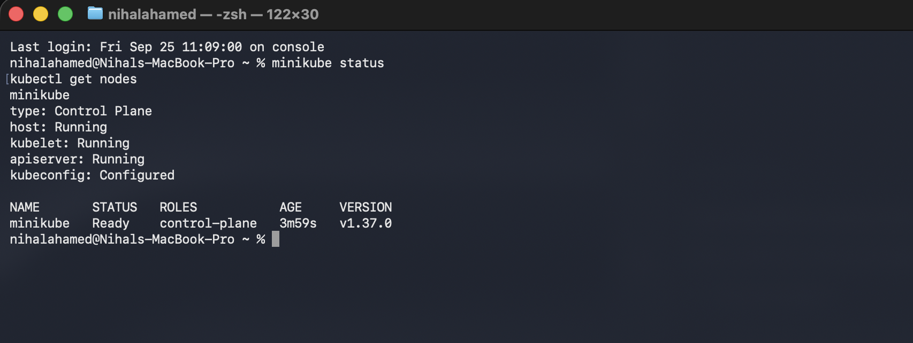
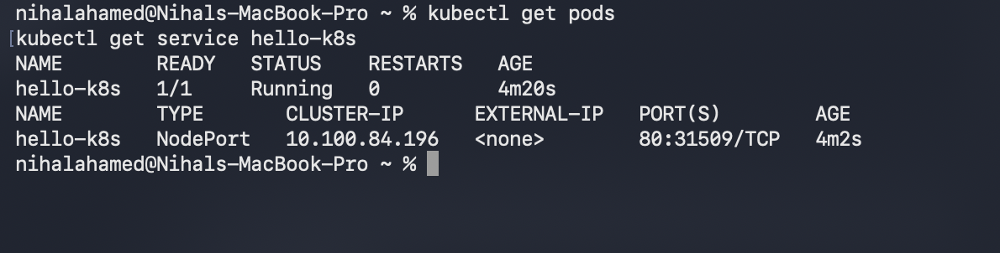
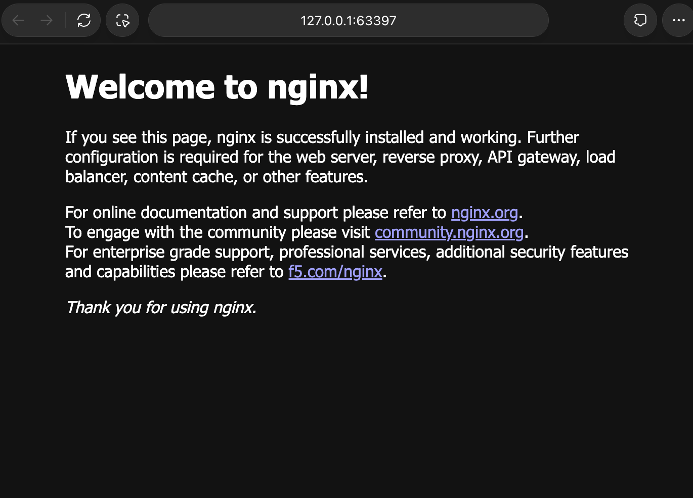

# Exercise 1 — Results

Completed by [nihal-toki](https://github.com/nihal-toki) on 19 October 2026.

| Check | Observed result |
| --- | --- |
| Minikube | Host, kubelet, and API server Running; kubeconfig Configured |
| Node | minikube Ready |
| Pod | hello-k8s, 1/1 Ready, Running, 0 restarts |
| Service | hello-k8s, NodePort, 80:31509/TCP |
| Browser | Welcome to nginx! |

## Cluster status

## Pod and service

## Browser output

The browser used the local Minikube service tunnel. Its temporary localhost port can change between runs.

## Automated verification

Rechecked on 20 October 2026 using `verify.sh`: all five checks passed, including a ready service endpoint and HTTP 200. See [verification.json](evidence/verification.json) for measured values and the image digest, and [nginx-response.html](evidence/nginx-response.html) for the actual response. Ports and addresses are specific to each run.
