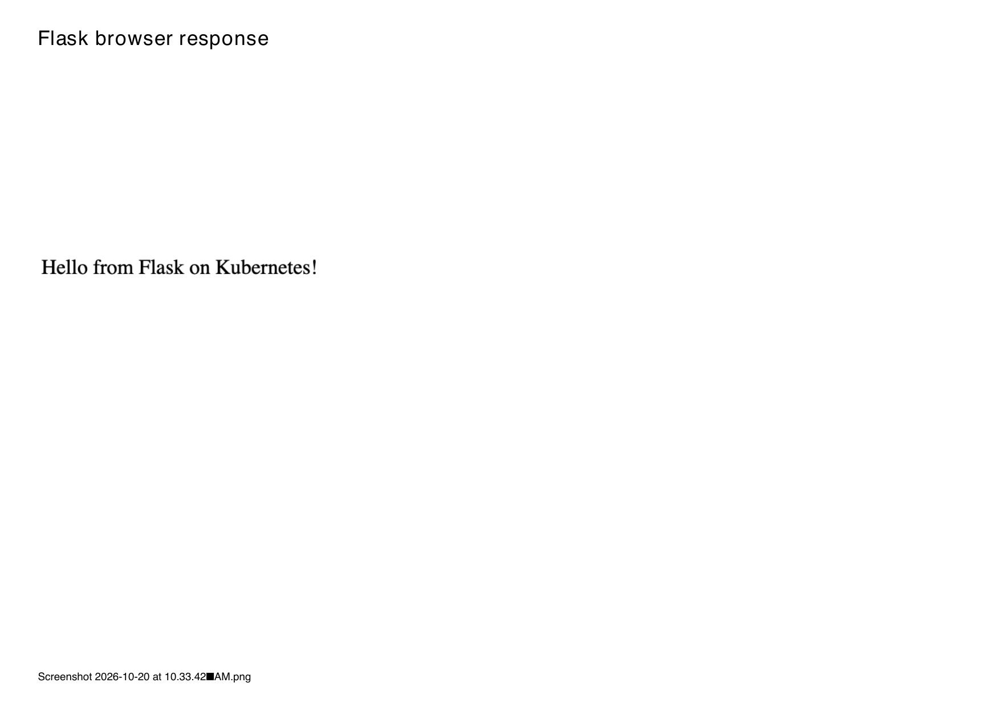

# Exercise 2 Results

The saved Deployment description records creation on 20 October 2026 at 10:30:44 +0530. The exact verification time and tool versions were not captured in the supplied evidence.

The deployment ran in namespace `default`. The original results below use the saved terminal evidence and screenshots. A supplementary isolated verification run on 24 October 2026 is recorded separately at the end.

## Image and deployment

The preserved Dockerfile uses `python:3.9-slim` and pins Flask 3.1.3. The Deployment uses image `flask-k8s-app:v1`, two replicas and `imagePullPolicy: Never`.

The [Deployment description](evidence/deployment-description.txt) records two desired, updated, total and available replicas, with zero unavailable. Both `Available` and `Progressing` conditions are `True`. The [pod screenshot](evidence/pods.png) shows both Flask pods `1/1 Running` with zero restarts, at `10.244.0.5` and `10.244.0.4`. The [deployment screenshot](evidence/deployment.png) shows `2/2` ready and two available replicas.

The [Flask startup logs](evidence/flask-startup.txt) show the app listening on all addresses at port `15000`. The Deployment description records container port `15000/TCP` and host port `0/TCP`.

## Before and after the Service

The original 20 October capture did not demonstrate a pre-Service connection failure. The supplementary 24 October run below now demonstrates it in an isolated namespace; the original evidence is preserved.

The [Service description](evidence/service-description.txt) records:

| Setting | Recorded value |
| --- | --- |
| Service | `flask-service` |
| Type | `NodePort` |
| ClusterIP | `10.101.226.195` |
| Service port | `15000/TCP` |
| Target port | `15000/TCP` |
| NodePort | `30080/TCP` |
| Endpoints | `10.244.0.4:15000`, `10.244.0.5:15000` |

The two endpoint addresses match the Flask pod addresses in the screenshot. The [Service screenshot](evidence/service.png) also shows `flask-service` exposed as `15000:30080/TCP`. The saved [curl response](evidence/curl-response.txt) and [browser response screenshot](evidence/flask-response.png) contain:

```text
Hello from Flask on Kubernetes!
```

The [Kubernetes logs](evidence/kubernetes-logs.txt) show Flask listening at `10.244.0.5:15000` and `10.244.0.4:15000`. They record `GET / HTTP/1.1` with status **200** at `20/Oct/2026 05:03:20`. A separate favicon request returned 404; that does not indicate failure of the home route.

`curl-response.txt` records the successful response body, but contains neither the invocation URL nor HTTP headers/status. The 200 status above comes from the application log, not from a fabricated curl transcript. The original run did not include unit tests; the supplementary test results are recorded below. Obtain a current access URL with `minikube service flask-service --namespace default --url` when repeating the exercise.



Implementation differences from the question sheet: this run uses **two replicas instead of one**, names its resources `flask-deployment` and `flask-service`, and defines the Service in a separate `flask-service.yaml`. The saved implementation uses `flask-k8s-app:v1` and namespace `default`. These settings and the application were preserved during evidence organization.

## Recorded output

- [Deployment description](evidence/deployment-description.txt)
- [Flask startup logs](evidence/flask-startup.txt)
- [Service description and endpoints](evidence/service-description.txt)

- [Kubernetes pod logs and HTTP status](evidence/kubernetes-logs.txt)
- [Curl response body](evidence/curl-response.txt)
- [Deployment screenshot](evidence/deployment.png)
- [Service screenshot](evidence/service.png)
- [Pod screenshot](evidence/pods.png)
- [Browser response screenshot](evidence/flask-response.png)

The four images are unchanged full-page PNG captures from the owner's supplied `DevOps_Exercise_2_Final.pdf`: pages 4, 5, 7 and 6 respectively. The PDF's pod capture clips the bottom of an unrelated Exercise 1 row; both Exercise 2 pod rows are visible. The browser-response capture contains the message but no address bar, so its URL is not inferred.

## Supplementary verification — 24 October 2026

The missing checks were performed on the existing Minikube cluster using fresh namespace `exercise2-check-8586d6c8`. This was a new run, not a reconstruction of 20 October. The original `default` namespace deployment and its Service on NodePort `30080` were left intact.

Before creating any Service in the temporary namespace, the Deployment reached two available replicas. The namespace had **zero Services**, and `curl http://127.0.0.1:15000/` failed with **exit code 7 (connection refused)**. The timestamp, namespace, URL and actual curl error are saved in [before-service.json](evidence/before-service.json). This demonstrates that the container port does not automatically publish a host port; it does not assert that no Services existed in other namespaces.

After creating the temporary Service, its dynamically allocated NodePort was `32557`, with two ready endpoints at `10.244.0.8:15000` and `10.244.0.9:15000`. The Minikube tunnel URL `http://127.0.0.1:56050/` returned **HTTP 200** and exactly `Hello from Flask on Kubernetes!`. The actual curl command, response headers and body are saved in [service-http-response.txt](evidence/service-http-response.txt). The tunnel URL and temporary node port are specific to this run.

All **seven verification groups passed**: absence of a Service before exposure, host connection refusal, Deployment image/pull policy/replicas, two ready pods, Service ports and ready endpoints, HTTP status/body, and API-server dry runs. See [verification.json](evidence/verification.json), [deployment.txt](evidence/deployment.txt) and [service.txt](evidence/service.txt).

Both tests in `test_app.py` passed in a separate process inside an existing Flask container: the home route returned HTTP 200 with the expected body, and an unknown route returned 404. See [unit-tests.txt](evidence/unit-tests.txt). No application files were modified by these tests.

The verification tunnel was closed and the temporary namespace was removed; [verification-cleanup.json](evidence/verification-cleanup.json) records cleanup. The original application code, Dockerfile, manifests, screenshots and historical evidence remain unchanged.

The previously missing execution evidence is now recorded. No new screenshot of the curl command or pre-Service failure was taken; their genuine text measurements are linked above. The two-replica/resource-name/separate-Service differences from the question sheet remain documented rather than changing the working implementation.
