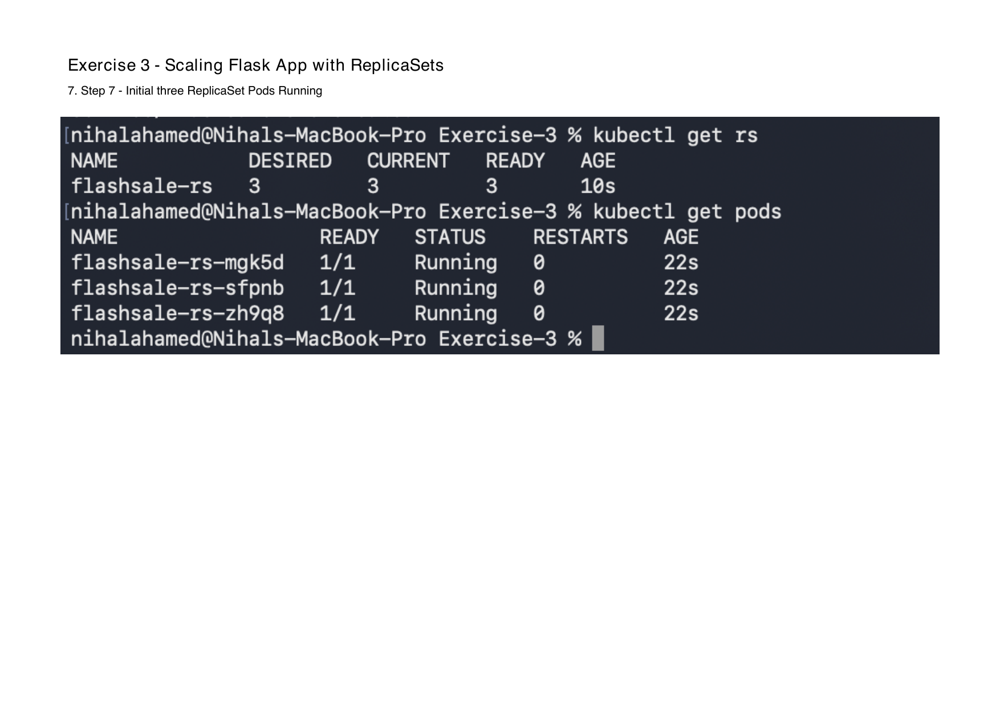
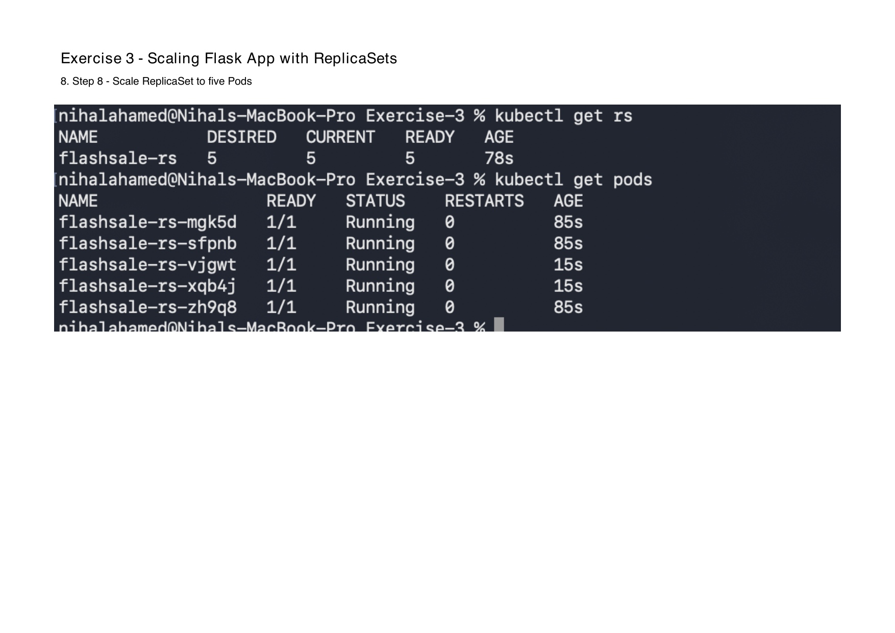
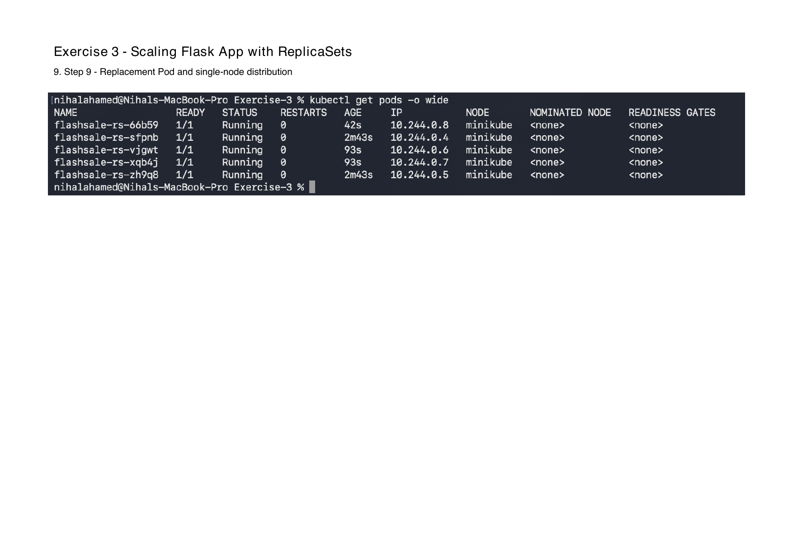
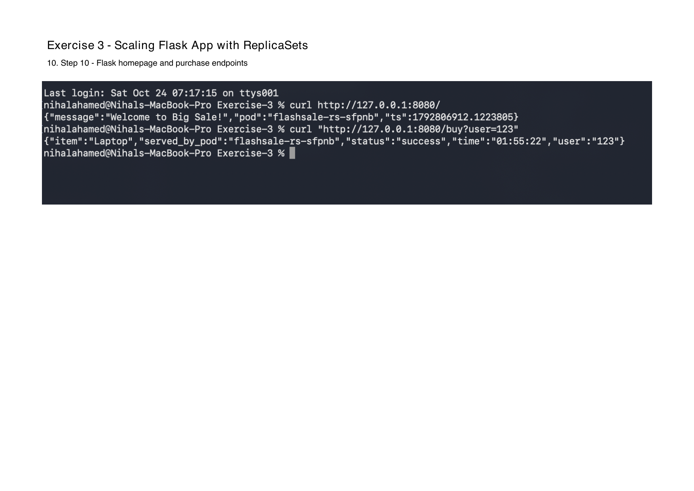

# Exercise 3 Results

**Exercise:** Scaling Flask App on Single Node Using ReplicaSets  
**Platform:** macOS (Apple Silicon)  
**Date:** 24 October 2026

## 1. Minikube Cluster

Minikube v1.39.0 was started with Docker Desktop using a single node.

Kubernetes version: v1.37.0.

The node initially reported `NotReady` during startup and subsequently reached `Ready`.

Command:

```bash
kubectl get nodes
```

**Observed result:** One `minikube` control-plane node in `Ready` state.

Evidence: [nodes.txt](evidence/nodes.txt)

## 2. Initial ReplicaSet Deployment

The Flask application was packaged as Docker image `flashsale:1.0` and loaded into Minikube.

The ReplicaSet `flashsale-rs` was created with 3 replicas.

**Observed result:** 3 desired, 3 current, and 3 ready Pods, with zero restarts.

## 3. Scaling from 3 to 5 Replicas

Command:

```bash
kubectl scale rs flashsale-rs --replicas=5
```

**Observed result:** 5 desired, 5 current, and 5 ready Pods.

Kubernetes created two additional Pods without deleting the original three.

Evidence: [replicaset.txt](evidence/replicaset.txt)

## 4. Automatic Pod Replacement

The Pod `flashsale-rs-mgk5d` was deleted.

Kubernetes automatically created replacement Pod `flashsale-rs-66b59`.

**Observed result:** The ReplicaSet returned to five running Pods, demonstrating self-healing.

The ReplicaSet description includes `SuccessfulCreate` events.

Evidence: [replicaset-description.txt](evidence/replicaset-description.txt)

## 5. Pod Distribution

All five Pods were scheduled on the single `minikube` node.

| Pod | IP address | Status |
|---|---|---|
| flashsale-rs-66b59 | 10.244.0.8 | Running |
| flashsale-rs-sfpnb | 10.244.0.4 | Running |
| flashsale-rs-vjgwt | 10.244.0.6 | Running |
| flashsale-rs-xqb4j | 10.244.0.7 | Running |
| flashsale-rs-zh9q8 | 10.244.0.5 | Running |

All Pods reported `1/1` readiness and zero restarts.

Evidence: [pods-distribution.txt](evidence/pods-distribution.txt)

## 6. Kubernetes Service

Service name: `flashsale-svc`

Service type: `ClusterIP`

Service port: `80`

Container target port: `5000`

The Service was accessed from macOS using:

```bash
kubectl port-forward service/flashsale-svc 8080:80
```

Evidence: [service.txt](evidence/service.txt)

## 7. Flask Application Verification

The following endpoints were tested successfully.

| Endpoint | Observed result |
|---|---|
| `/` | Welcome to Big Sale! |
| `/buy?user=123` | Successful simulated purchase of a Smartphone |
| `/health` | Healthy |

The recorded requests were served by Pod `flashsale-rs-sfpnb`.

Evidence:

- [Homepage response](evidence/homepage-response.json)
- [Purchase response](evidence/buy-response.json)
- [Health response](evidence/health-response.json)

## 8. Resource Configuration

The ReplicaSet uses the following resource configuration per container.

| Resource | Request | Limit |
|---|---|---|
| CPU | 100m | 500m |
| Memory | 128Mi | 256Mi |

Both readiness and liveness probes use the `/health` endpoint on port 5000.

## 9. Final Verification

| Check | Result |
|---|---|
| Single-node Minikube | Passed |
| Initial 3 replicas | Passed |
| Scaling to 5 replicas | Passed |
| Automatic Pod replacement | Passed |
| Five Pods running on one node | Passed |
| Flask homepage | Passed |
| Flash Sale purchase endpoint | Passed |
| Health endpoint | Passed |
| ReplicaSet description | Verified |

## Conclusion

Exercise 3 successfully demonstrated Kubernetes ReplicaSet scaling and self-healing on a single-node Minikube cluster running on macOS.

The ReplicaSet was scaled from three to five replicas. After one Pod was deleted, Kubernetes automatically created a replacement to maintain the desired replica count.

All three Flask endpoints returned the expected responses.

## 10. Original screenshot evidence

The supplied PDF confirms the original run's initial three pods, subsequent five pods, replacement pod, node placement and endpoint responses. The screenshot response and saved JSON response are separate requests, so their random purchase items and timestamps can differ.









The screenshot filenames and their source PDF page numbers are listed in README.md. They are unchanged page captures. No standalone browser screenshot was supplied; the genuine terminal curl captures show the responses.

## 11. Supplementary automated verification

On 24 October 2026, a separate run used temporary namespace `exercise3-check-cd5a8ae7` on the existing single-node cluster. The original five pods in `default` were not scaled or deleted.

The initial three pod UIDs were retained when scaling to five. The test then deleted `flashsale-rs-9jttk` (UID `0cd177e8-539f-4a85-923b-54b08ef19ca6`); the controller created `flashsale-rs-b8sst` (UID `6efaf212-08e8-4f77-adb3-ff33cad02b13`) and restored five ready pods. All five ran on `minikube`, with five ready Service endpoints.

The image, pull policy, readiness/liveness probes, CPU/memory requests and limits matched the existing manifest. Kubernetes accepted it in a server-side dry run. All five Flask unit tests passed: homepage, supplied purchase user, generated purchase user, health and unknown route.

The homepage and health endpoints returned HTTP 200 with the expected JSON. All 100 purchase requests to `/buy?user=lab-test` through the ClusterIP Service succeeded and reached every pod:

| Pod | Successful requests |
| --- | ---: |
| flashsale-rs-z2vxk | 22 |
| flashsale-rs-b8sst | 21 |
| flashsale-rs-wsqvv | 18 |
| flashsale-rs-twzdq | 19 |
| flashsale-rs-dk984 | 20 |

This measures Service distribution; it does not measure peak capacity or prove equal traffic over time. The purchases are simulated and are not stored.

All ten verification groups passed. The temporary namespace was removed afterward; its cleanup is recorded separately.

- [Pod UIDs, replacement, image ID, endpoints and HTTP distribution](evidence/verification.json)
- [Five passing unit tests](evidence/unit-tests.txt)
- [Supplementary final resources](evidence/resources.txt)
- [Temporary namespace cleanup](evidence/verification-cleanup.json)

## 12. Remaining publication evidence

The image was built locally and loaded into Minikube. No Docker Hub push or remote registry digest evidence is available; publishing remains separate if the instructor requires that question-sheet step. No publication was fabricated. The original application, Dockerfile, manifest and historical text evidence were preserved.
