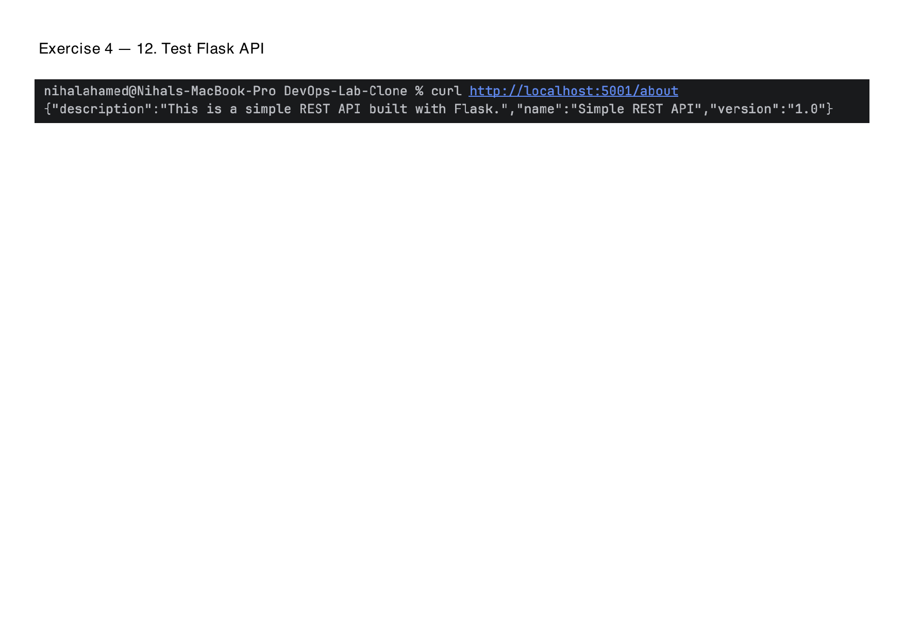

# Exercise 4 Results

Run date: 24 October 2026, macOS with Docker Desktop. The original owner-run results below are supported by the supplied screenshots. A supplementary automated run is recorded separately; its IDs and localhost port differ from the original run.

## Network and containers

The original run created `my-bridge-net` with driver `bridge`, scope `local`, subnet `172.18.0.0/16` and gateway `172.18.0.1`. The short network ID was `559849d700bd`. The built image was `flask-api:latest` (short image ID `d0b4c605d8f9`).

| Original container | Image | Bridge address | Port |
| --- | --- | --- | --- |
| mysql | mysql:8.4 | 172.18.0.2 | 3306 internally |
| redis | redis:7 | 172.18.0.3 | 6379 internally |
| flask | flask-api:latest | 172.18.0.4 | Host 5001 to container 5001 |

All three containers were running and attached to the bridge. Flask's `/about` at `http://localhost:5001/about` returned:

```json
{"description":"This is a simple REST API built with Flask.","name":"Simple REST API","version":"1.0"}
```



## Connectivity

The original Flask-container socket checks resolved `mysql` and `redis` to their bridge addresses and connected to ports 3306 and 6379. Redis returned `PONG`, and the original MySQL query returned version `8.4.13`. The original screenshots demonstrate TCP connectivity; ICMP ping evidence is provided by the separate automated run below.

The `/about` handler does not access the database or cache. These checks demonstrate network/server connectivity rather than application-level database or cache integration.

## Cleanup

The original screenshots show `mysql`, `redis` and `flask` stopped and removed, followed by removal of `my-bridge-net`. The final listing retains the existing Minikube network.

## Supplementary automated verification

A fresh stack used network `exercise4-check-c9d298a1-net`, with uniquely named containers and DNS aliases `mysql`, `redis` and `flask`. Its bridge subnet was `172.18.0.0/16`; the MySQL, Redis and Flask addresses were `.2`, `.3` and `.4` respectively.

Both the standalone Flask test and the three-container API test returned HTTP 200 with the exact expected JSON. The networked API URL was `http://127.0.0.1:60804/about`; the host port was allocated dynamically. MySQL and Redis had no published host ports.

From inside Flask, both server names resolved to the inspected container addresses. Three pings to each server had zero packet loss. MySQL accepted TCP and sent protocol 10 with version `8.4.13`. An authenticated query listed `devopsdb`, `information_schema`, `mysql`, `performance_schema` and `sys`. Redis returned `PONG` through both the raw Redis protocol and `redis-cli`.

All **three unit tests passed**: expected `/about` JSON/status, unknown-route 404 and POST rejection with 405. All **ten networking/API verification groups passed**. Installed application versions were Python `3.9.25`, Flask `2.0.1` and Werkzeug `2.0.3`.

Only the disposable verification container received `iputils-ping`; the project's Dockerfile was unchanged. Cleanup removed the temporary containers, their disposable volumes and network. No owned containers remained; all previously existing Docker networks were preserved. Images were retained.

## Evidence

Supplementary machine-readable evidence:

- [Build output](evidence/build.txt)
- [Standalone API check](evidence/standalone.json)
- [Application versions](evidence/app-versions.json)
- [Network inspection](evidence/network-inspection.json)
- [DNS, ping, TCP, MySQL, Redis and API checks](evidence/verification.json)
- [Unit tests](evidence/unit-tests.txt)
- [Diagnostic tool installation](evidence/diagnostic-tool-install.txt)
- [Cleanup confirmation](evidence/cleanup.json)

Original screenshot evidence is preserved as unchanged full-page PNG captures from `Exercise_4_Screenshots.pdf`:

| PDF page | Screenshot |
| --- | --- |
| 1 | [Bridge creation](evidence/network-created.png) |
| 3 | [Original network inspection](evidence/network-inspection.png) |
| 5 | [Built Flask image](evidence/flask-image.png) |
| 11 | [Running containers](evidence/containers.png) |
| 12 | [Curl API response](evidence/about-response.png) |
| 13 | [MySQL TCP connectivity](evidence/mysql-connectivity.png) |
| 14 | [Redis TCP connectivity](evidence/redis-connectivity.png) |
| 15 | [Bridge members](evidence/network-members.png) |
| 16 | [Redis PONG](evidence/redis-pong.png) |
| 19 | [Container cleanup](evidence/containers-cleanup.png) |
| 20 | [Network cleanup](evidence/network-cleanup.png) |
| 21 | [Final cleanup listing](evidence/cleanup-confirmation.png) |

No standalone browser screenshot was supplied; the original terminal curl capture is used without relabelling it as a browser screenshot. The practical tasks and supplementary checks are complete; no execution result was invented.
